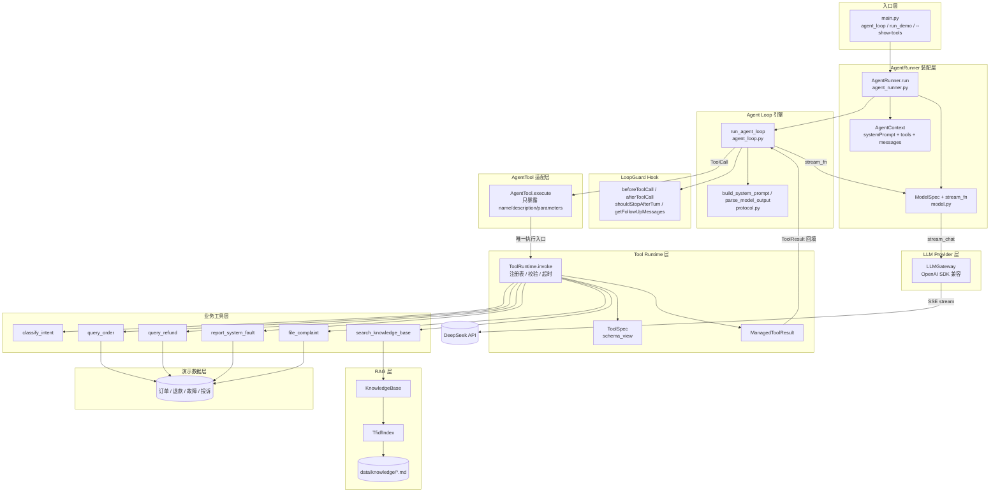
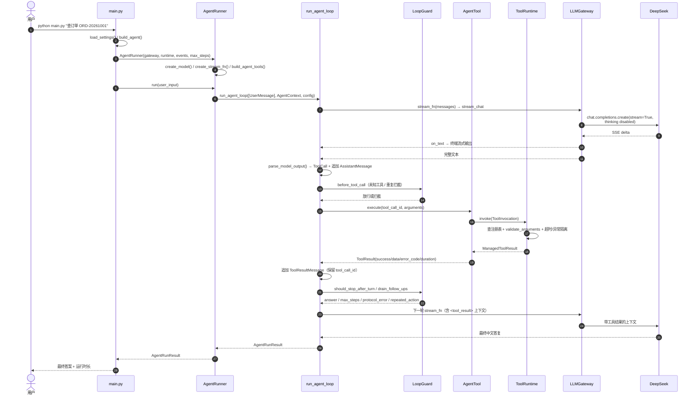

# 智能工单处理平台 Agent

基于 DeepSeek API 的最小但完整的工单处理 Agent，并按 **pi 框架的分层思想**（`@earendil-works/pi-agent-core` + `pi-ai`）用 Python 重构：

**Model → AgentContext → AgentTool → ToolRuntime.invoke → Agent Loop Hook → LoopGuard → AgentRunner → RAG**

实现了「用户输入 → LLM 决策 → 解析 Tool Call → Tool Runtime 执行 → Tool Result 回填 → 下一轮 LLM → 最终回答」的完整闭环。

- 模型：`deepseek-v4-flash`（可通过 `DEEPSEEK_MODEL` 覆盖）
- 调用方式：OpenAI SDK 兼容接口，`stream=True`，`extra_body={"thinking": {"type": "disabled"}}`
- 密钥：环境变量 `DEEPSEEK_API_KEY`
- 测试：53 个确定性测试 + 1 个真实 API 联调测试
- 运行入口：[main.py](main.py)，`asyncio.run(agent_loop(""))` 即交互模式

---

## 1. 快速开始

```bash
cd ticket_agent

# 1) 创建虚拟环境
python -m venv .venv

# Windows PowerShell
.venv\Scripts\Activate.ps1
# macOS / Linux
source .venv/bin/activate

# 2) 安装依赖
pip install -r requirements.txt

# 3) 配置密钥（PowerShell）
$env:DEEPSEEK_API_KEY="sk-xxxx"
# 或使用项目 .env（参考 .env.example）
```

运行：

```bash
# 交互模式（无参数，等价于 asyncio.run(agent_loop(""))）
python main.py

# 单轮问答
python main.py "帮我查订单 ORD-20261001 的物流，顺便看一下退款进度"

# 内置业务场景（订单+退款 / RAG 咨询 / 故障 / 投诉）
python main.py --demo

# 打印关键事件
python main.py --demo --verbose

# 查看模型可见的工具 schema（不调用模型）
python main.py --show-tools
```

测试：

```bash
pytest -q

# 真实 DeepSeek 联调（会消耗 token）
$env:RUN_LIVE="1"
$env:DEEPSEEK_MODEL="deepseek-v4-flash"
pytest tests/test_live_deepseek.py -q -s
```

依赖说明：

| 依赖 | 用途 |
| --- | --- |
| `openai>=1.40` | 以 OpenAI SDK 兼容方式调用 DeepSeek（异步、流式） |
| `python-dotenv>=1.0` | 读取 `.env`（环境变量优先，不覆盖进程变量） |
| `pytest` / `pytest-asyncio` | 分层、模块、集成测试 |

> `DEEPSEEK_BASE_URL` 默认 `https://api.deepseek.com`。如果环境变量指向 Anthropic 兼容路径（如 `.../anthropic`），本项目会自动回退到官方 OpenAI 兼容地址，因为该路径不提供 `/chat/completions`。

---

## 2. 系统设计

### 2.1 分层设计（pi 映射）

本项目不直接依赖 TypeScript 的 pi 包，而是用 Python 按 pi 的分层与约束重实现：模型接入、AgentContext、AgentTool 适配、ToolRuntime.invoke、Agent Loop Hook、LoopGuard、装配层与事件观察各自独立。

| pi 层 | 本项目文件 | 职责 |
| --- | --- | --- |
| `model.ts` | [model.py](ticket_agent/model.py) | 声明逻辑模型（provider/api/base_url），把网关包装成 `stream_fn` |
| `agent-runner.ts` | [agent_runner.py](ticket_agent/agent_runner.py) | 组装 AgentContext / AgentLoopConfig / Hook，观察事件并产出结果 |
| `pi-agent-core` Loop | [agent_loop.py](ticket_agent/agent_loop.py) | turn 推进、流式调用、ToolCall 执行、ToolResult 回填 |
| `loop-guard.ts` | [loop_guard.py](ticket_agent/loop_guard.py) | 最大轮次、协议纠偏一次、重复工具调用拦截 |
| `pi-tools.ts` | [agent_tool.py](ticket_agent/agent_tool.py) + [tools/__init__.py](ticket_agent/tools/__init__.py) | 把 ToolSpec 适配成模型可见的 AgentTool |
| `runtime.ts` | [runtime.py](ticket_agent/runtime.py) | `ToolRuntime.invoke()` 唯一执行入口，参数校验 / 超时 / 结构化结果 |
| 提示词与协议层 | [protocol.py](ticket_agent/protocol.py) | System Prompt 渲染、ToolCall JSON 解析 |
| 上下文层 | [agent_context.py](ticket_agent/agent_context.py) | systemPrompt + messages + tools |
| 入口层 | [main.py](main.py) | 参数解析、交互/演示模式、最终答案与运行时长 |
| LLM Provider 层 | [gateway.py](ticket_agent/gateway.py) | DeepSeek OpenAI 兼容流式调用与异常封装 |
| 业务工具层 | [tools/](ticket_agent/tools/) | 意图、订单、退款、知识库、故障、投诉 |
| RAG 层 | [rag.py](ticket_agent/rag.py) | Markdown 切分 + TF-IDF 检索 |
| 消息模型层 | [messages.py](ticket_agent/messages.py) | User / Assistant / ToolResult 消息、ToolCall / ToolResult |
| 可观测层 | [events.py](ticket_agent/events.py) | `AgentEvent` 与 verbose `EventLogger` |
| 演示数据层 | [tools/data.py](ticket_agent/tools/data.py) | 订单、退款、故障、投诉内存仓储 |

分层约束：

- Agent Loop 不直接引用任何业务 handler，只调用 `AgentTool.execute()`。
- `AgentTool.execute()` 只做 adapter，统一转入 `ToolRuntime.invoke()`。
- 停止条件与协议纠偏不在循环引擎里硬编码，由 `LoopGuard` 通过 Hook 提供。

### 2.2 内部消息结构

```python
ToolCall(tool_call_id, name, arguments)
ToolResult(tool_call_id, name, success, data, error_code, error_message, duration_ms)

UserMessage(content)
AssistantMessage(raw_text, blocks=[TextBlock | ToolCallBlock])
ToolResultMessage(result)   # role="tool"，序列化时带 tool_call_id
```

- 助手消息可以同时包含文本块与 `toolCall` 块；`AssistantMessage.text` 会自动剔除工具调用 JSON，只保留自然语言。
- 工具结果回填为带 `<tool_result tool_call_id="..." name="..." success="...">` 标签的上下文。由于本项目采用**文本工具协议**而不是原生 function calling，回填时使用 `user` 角色，但 `tool_call_id` 完整保留，保证调用与结果一一对应。

### 2.3 工具调用协议

系统提示词中只注入工具的名称、描述与参数 schema，**不注入 handler**。模型需要调用工具时只输出：

```json
{"type":"tool_call","tool_call_id":"call_1","name":"query_order","arguments":{"order_id":"ORD-20261001"}}
```

解析器兼容：

- JSON 外包 ``` 代码块
- JSON 前后带自然语言说明
- `arguments` 为 JSON 字符串
- 模型未提供 `tool_call_id` 时自动生成 `call_<random>`（结果仍通过同一 id 回填）

### 2.4 Agent Loop

`agent_loop.run_agent_loop()` 对应 pi 的 `runAgentLoop`，循环本身只推进 turn 与触发 Hook：

```text
context = AgentContext(system_prompt, tools)
for turn in 1..max_steps:
    turn_start
    openai_messages = context.llm_messages()
    流式调用 stream_fn，边打印边累积文本（message_update）
    parsed = protocol.parse_model_output(text)
    追加 AssistantMessage(raw_text, [TextBlock, ToolCallBlock...])
    for call in parsed.tool_calls:
        before = LoopGuard.before_tool_call(call)   # 未知工具 / 重复调用拦截
        result = AgentTool.execute(call) → ToolRuntime.invoke(...)
        追加 ToolResultMessage(result)              # 保留 tool_call_id
        LoopGuard.after_tool_call(result)
    decision = LoopGuard.should_stop_after_turn(...)
    follow_ups = LoopGuard.drain_follow_ups()       # 协议纠偏提示
    prepare_next_turn
    if decision.stop: break
```

Hook 与 pi 的对应关系：

| pi Hook | 本项目实现 | 作用 |
| --- | --- | --- |
| `beforeToolCall` | `LoopGuard.before_tool_call` | 未知工具拦截、相同调用重复 3 次拦截 |
| `afterToolCall` | `LoopGuard.after_tool_call` | 工具执行后的观测点 |
| `shouldStopAfterTurn` | `LoopGuard.should_stop_after_turn` | 无工具调用即结束、协议纠偏、最大轮次 |
| `getFollowUpMessages` | `LoopGuard.drain_follow_ups` | 把协议错误提示回填到下一轮 |
| `prepareNextTurn` | `LoopGuard.prepare_next_turn` | 刷新下一轮 AgentContext |

协议异常时最多纠正一次：把错误原因回填给模型，要求其输出合法 JSON 或直接回答，避免无限重试。

### 2.5 ToolRuntime

- **唯一执行入口**：`ToolRuntime.invoke(ToolInvocation) -> ManagedToolResult`；`ToolInvocation` 携带 `tool_call_id / model_name / args / signal`。
- **注册表**：`_specs: dict[name, ToolSpec]`；每个 `ToolSpec` 持有 `handler`，但 `schema_view()` 只返回 `name/description/parameters`。
- **AgentTool 适配**：`AgentTool.execute(tool_call_id, params, signal)` 只负责转发到 `invoke()`，模型侧视图不含 runtime 与 handler。
- **参数校验**：`required`、JSON 类型（区分 `bool` 与 `int`）、`enum`、`additionalProperties=false`。
- **统一执行**：同步 handler 放入线程池，异步 handler 直接 await；统一 `asyncio.wait_for` 超时。
- **结构化结果**：`ManagedToolResult` 包装 `ToolResult`，提供 `ok / code / model_view / duration_ms`。
- **错误码**：`TOOL_NOT_FOUND`、`INVALID_ARGUMENTS`、`TOOL_TIMEOUT`、`TOOL_EXECUTION_FAILED`、`TOOL_RESULT_NOT_SERIALIZABLE`、`REPEATED_ACTION`，以及业务错误码（如 `ORDER_NOT_FOUND`）。

### 2.6 RAG

- 知识库：[data/knowledge/](data/knowledge/)，5 个 Markdown 文档（耳机、手环、账号、售后退款、发票保修）。
- 切分：按 Markdown 标题与空行切段，段落保留所属标题。
- 检索：中文**汉字二元组** + 英文/数字词，TF-IDF 权重 + 余弦相似度，零第三方依赖。
- 返回：`source / section / score / content`，`top_k` 限制在 1–5，未命中返回 `KB_NO_MATCH`。

### 2.7 意图识别

`classify_intent` 是确定性规则分类器（可审计、可测试），覆盖：退款、订单物流、产品咨询、系统故障、投诉、其他。返回类别、置信度、命中关键词与建议工具，供模型决定下一步调用。

---

## 3. 技术架构图



---

## 4. 功能模块划分

```text
ticket_agent/
├── main.py                     入口：交互模式 / 单轮 / demo / show-tools
├── ticket_agent/
│   ├── config.py               环境变量、base_url 规整、Settings
│   ├── events.py               AgentEvent + verbose EventLogger
│   ├── messages.py             User/Assistant/ToolResult 消息、ToolCall/ToolResult
│   ├── gateway.py              LLMGateway（流式、密钥校验、异常封装）
│   ├── model.py                ModelSpec + stream_fn（pi model.ts 对应）
│   ├── agent_context.py        AgentContext：systemPrompt + tools + messages
│   ├── protocol.py             System Prompt 渲染 + ToolCall JSON 解析
│   ├── agent_tool.py           AgentTool 适配（模型视图不含 handler）
│   ├── agent_loop.py           run_agent_loop：turn / 流式 / 工具执行 / 回填
│   ├── loop_guard.py           Hook：最大轮次 / 协议纠偏 / 重复调用拦截
│   ├── agent_runner.py         AgentRunner：装配 Loop + Hook + 事件观察
│   ├── runtime.py              ToolSpec / ToolRuntime.invoke / ManagedToolResult
│   ├── rag.py                  Markdown 切分 + TF-IDF + 余弦相似度
│   └── tools/
│       ├── __init__.py         build_runtime + build_agent_tools
│       ├── data.py             订单 / 退款 / 故障 / 投诉内存仓储
│       ├── intent.py           意图识别分类
│       ├── order.py            订单详情查询
│       ├── refund.py           退款进度查询
│       ├── knowledge.py        产品咨询（RAG 工具封装）
│       ├── fault.py            系统故障登记与诊断采集
│       └── complaint.py        用户投诉登记
├── data/knowledge/*.md         5 个知识库文档
├── tests/                      分层 / 模块 / 集成 / live 测试
├── requirements.txt
└── pytest.ini
```

| 业务模块 | 能力 | 实现 |
| --- | --- | --- |
| 意图识别 | 分类 + 置信度 + 建议工具 | `tools/intent.py` |
| 订单服务 | 订单状态、商品、金额、物流、售后政策 | `tools/order.py` |
| 退款服务 | 退款单进度、时间线、按订单号反查 | `tools/refund.py` |
| 产品咨询 | RAG 检索产品使用、账号、保修、发票知识 | `tools/knowledge.py` + `rag.py` |
| 故障处理 | 登记故障、错误签名、日志快照、团队分派、SLA | `tools/fault.py` |
| 投诉处理 | 投诉单号、优先级、责任团队、SLA | `tools/complaint.py` |

---

## 5. 代码调用链路图



实际函数调用链：

```text
main.main
└─ asyncio.run(agent_loop(question))
   ├─ load_settings() / EventLogger()
   ├─ build_agent()
   │  ├─ KnowledgeBase.load(KNOWLEDGE_DIR) → load_markdown_chunks() → TfidfIndex()
   │  ├─ build_runtime(kb) → ToolRuntime.register(intent/order/refund/knowledge/fault/complaint)
   │  ├─ build_agent_tools(runtime) → AgentTool（只含 name/description/parameters）
   │  ├─ create_model(settings) / create_stream_fn(gateway)
   │  └─ build_system_prompt(tools) → AgentRunner(...)
   ├─ AgentRunner.run(user_input)
   │  ├─ AgentContext(system_prompt, tools, []) / LoopGuard(max_steps)
   │  ├─ run_agent_loop(prompts, context, AgentLoopConfig)
   │  │  ├─ context.llm_messages() → to_openai_messages(system_prompt, messages)
   │  │  ├─ stream_fn → LLMGateway.stream_chat() → AsyncOpenAI.chat.completions.create(stream=True, extra_body=...)
   │  │  ├─ protocol.parse_model_output() → _scan_json_objects() → ToolCall
   │  │  ├─ LoopGuard.before_tool_call() → AgentTool.execute()
   │  │  │  └─ ToolRuntime.invoke(ToolInvocation)
   │  │  │     ├─ validate_arguments()
   │  │  │     ├─ handler(**arguments)（async 直接 await / sync 走 to_thread）
   │  │  │     └─ ManagedToolResult(ToolResult)
   │  │  ├─ ToolResultMessage → ToolResult.to_context()
   │  │  └─ LoopGuard.should_stop_after_turn() / drain_follow_ups()
   │  └─ 事件观察：agent_start / llm_request / assistant_stream / tool_start / tool_end / agent_end
   └─ _run_question() 打印最终答案与运行时长
```

---

## 6. 工具清单

| 工具 | 业务功能 | 关键参数 | 数据/错误码 |
| --- | --- | --- | --- |
| `classify_intent` | 用户意图识别分类 | `text` | 返回 category / confidence / suggested_tools |
| `query_order` | 订单详情与物流查询 | `order_id` | `ORDER_NOT_FOUND`、`INVALID_ARGUMENTS` |
| `query_refund` | 退款进度查询 | `refund_id` 或 `order_id` | `REFUND_NOT_FOUND`、`INVALID_ARGUMENTS` |
| `search_knowledge_base` | 产品使用咨询（RAG） | `question`、`top_k` | `KB_NO_MATCH` |
| `report_system_fault` | 系统故障登记与诊断采集 | `title`、`description`、`severity`、`affected_service`、`contact`、`platform`、`app_version` | 返回 fault_id、团队、SLA、日志快照 |
| `file_complaint` | 用户投诉登记 | `summary`、`detail`、`order_id`、`contact`、`expectation` | 返回 complaint_id、优先级、SLA |

模型只能看到上述名称、描述和参数 schema（`python main.py --show-tools` 可查看），看不到 handler。

---

## 7. 运行示例输出

`python main.py --demo --verbose`（真实 DeepSeek 调用，节选）：

```text
============================================================
用户: 你好，我 10 月 20 日买的无线降噪耳机 Pro，订单号 ORD-20261001，物流好几天没更新，帮我查一下订单详情和退款进度。
------------------------------------------------------------
[agent_start] input='...' model=deepseek-v4-flash
[llm_request] step=1 messages=2
[assistant_stream] step=1
{"type":"tool_call","tool_call_id":"call_1","name":"query_order","arguments":{"order_id":"ORD-20261001"}}
[message_end] step=1 chars=105 tool_calls=1 parse_error=
[tool_start] name=query_order tool_call_id=call_1 arguments="{'order_id': 'ORD-20261001'}"
[tool_end] name=query_order tool_call_id=call_1 success=True error_code= duration_ms=0.17
[llm_request] step=2 messages=4
[assistant_stream] step=2
{"type":"tool_call","tool_call_id":"call_2","name":"query_refund","arguments":{"order_id":"ORD-20261001"}}
[message_end] step=2 chars=106 tool_calls=1 parse_error=
[tool_start] name=query_refund tool_call_id=call_2 arguments="{'order_id': 'ORD-20261001'}"
[tool_end] name=query_refund tool_call_id=call_2 success=True error_code= duration_ms=0.25
[llm_request] step=3 messages=6
[assistant_stream] step=3
已为您查到订单和退款信息，结论如下：

**订单 ORD-20261001**
- 商品：无线降噪耳机 Pro（AUD-NC-PRO）× 1，金额 899 元
- 发货：2026-10-21 18:40，顺丰速运，运单号 SF1234567890
- 当前状态：运输中，预计送达 2026-10-29
- 售后政策：签收后支持 7 天无理由退货

**退款单 RF-20261001**
- 退款原因：物流长时间未更新
- 当前状态：审核中，预计 2026-10-31 到账
...
[message_end] step=3 chars=587 tool_calls=0 parse_error=
[agent_end] steps=3 stop_reason=answer tool_calls=2 duration_ms=4335.38

最终答案:
已为您查到订单和退款信息，结论如下：
...
运行时长: 4.34s | 轮次: 3 | 工具调用: 2
```

故障场景（demo 第三个业务）：

```text
{"type":"tool_call","tool_call_id":"call_1","name":"report_system_fault","arguments":{"title":"Android App 登录持续报 500 错误","severity":"high","affected_service":"登录","platform":"Android","app_version":"6.2.1",...}}
[tool_end] name=report_system_fault tool_call_id=call_1 success=True error_code= duration_ms=0.17

已为您登记系统故障，故障单号 **FLT-0001**。
- 状态：已受理    - 严重程度：高
- 处理团队：账号与安全组    - 响应时限：8 小时内首次响应
- 诊断追踪号：trace-flt-0001
运行时长: 2.39s | 轮次: 2 | 工具调用: 1
```

投诉场景会先 `query_order`、再 `query_refund`、最后 `file_complaint`，一次任务内完成 **3 次工具调用、4 轮 LLM**，并返回 `CMP-0001`、优先级与 SLA。

---

## 8. 功能测试

### 8.1 测试结果

```text
$ pytest -q
53 passed, 1 skipped in 3.82s

$ RUN_LIVE=1 pytest tests/test_live_deepseek.py -q -s
1 passed in 5.99s
```

- 确定性测试不依赖网络与 API Key，使用 `ScriptedGateway` 按脚本返回模型文本。
- live 测试使用真实 `deepseek-v4-flash`，验证模型能发起工具调用并生成最终答复。
- 环境：Python 3.12.7 / openai 3.40.0 / pytest 9.2.0。

### 8.2 分层功能测试（31 个）

| 文件 | 数量 | 覆盖点 |
| --- | --- | --- |
| [test_messages.py](tests/test_messages.py) | 9 | ToolCall/ToolResult 结构、`tool_call_id` 保留、文本块/toolCall 块、OpenAI 消息转换、JSON 解析（代码块、前后说明、字符串 arguments、非法 JSON） |
| [test_runtime.py](tests/test_runtime.py) | 15 | 注册表、schema 与 AgentTool 视图不泄露 handler、成功/未知工具/缺参/类型错误/enum、业务错误、同步 handler、超时、异常隔离、不可序列化结果、重复注册 |
| [test_rag.py](tests/test_rag.py) | 7 | 中文二元组分词、耳机/退款/发票检索命中、top_k、空查询、知识库统计 |

### 8.3 功能模块测试（12 个）

[test_tools.py](tests/test_tools.py) 覆盖 6 个业务工具的成功与失败路径：

- 意图分类 6 个类别 + 工具调用
- 订单命中 / `ORDER_NOT_FOUND`
- 退款按退款单号 / 按订单号 / `REFUND_NOT_FOUND`
- RAG 命中 / `KB_NO_MATCH`
- 故障登记（团队分派、SLA、诊断信息、持久化）
- 投诉登记（优先级、关联订单、未知订单、持久化）

### 8.4 业务场景集成测试（10 个）

[test_agent_loop.py](tests/test_agent_loop.py) 使用脚本化模型驱动完整 Agent Loop：

| 场景 | 断言 |
| --- | --- |
| 单工具后回答 | 2 轮、工具结果通过 `tool_call_id="call_1"` 回填、事件序列完整 |
| 多轮串行工具 | `classify_intent → query_order → answer`，3 轮 2 工具 |
| 工具业务错误 | 错误码 `ORDER_NOT_FOUND` 回填给模型后继续回答 |
| 未知工具 | `TOOL_NOT_FOUND` 不打断 Loop |
| RAG 咨询 | 命中耳机知识库并生成答复 |
| 故障 + 投诉 | 一次任务内连续登记两类工单 |
| 协议错误纠正 | 非法 JSON 触发一次纠正后恢复正常 |
| 最大轮次保护 | `stop_reason=max_steps`，输出兜底提示 |
| 重复工具调用拦截 | 相同 `name + arguments` 第 3 次被 `REPEATED_ACTION` 拦截并停止 |
| 流式输出 | 终端输出包含完整答复，`to_dict()` 可序列化 |

### 8.5 联调测试（1 个）

[test_live_deepseek.py](tests/test_live_deepseek.py)：设置 `RUN_LIVE=1` 后，真实调用 DeepSeek 查询 `ORD-20261001`，断言至少发生一次工具调用且最终答案非空。

---

## 9. 配置项

| 环境变量 | 默认值 | 说明 |
| --- | --- | --- |
| `DEEPSEEK_API_KEY` | 无（必填） | DeepSeek 密钥 |
| `DEEPSEEK_BASE_URL` | `https://api.deepseek.com` | OpenAI 兼容地址；`/anthropic` 路径自动回退 |
| `DEEPSEEK_MODEL` | `deepseek-v4-flash` | 模型名 |
| `AGENT_MAX_STEPS` | `8` | 最大推理轮次 |
| `AGENT_TEMPERATURE` | `0` | 采样温度 |
| `AGENT_REQUEST_TIMEOUT` | `60` | 单次 LLM 请求超时（秒） |
| `AGENT_VERBOSE` | `0` | 设为 `1` 等价于 `--verbose` |

`.env` 加载顺序：项目 `.env` → 仓库根 `.env`，已存在的进程环境变量优先。

---

## 10. 设计约束对照

| 题目禁止事项 | 本项目实现 |
| --- | --- |
| 不把 handler 暴露给模型 | `ToolSpec.schema_view()` / `AgentTool.schema_view()` / `describe_tools()` 只输出 name、description、parameters；测试断言不存在 `handler` |
| 不跳过 ToolRuntime | Agent Loop 仅调用 `AgentTool.execute()`，其内部唯一转入 `ToolRuntime.invoke()`，没有任何 handler 被直接引用 |
| 不省略 `tool_call_id` | `ToolCall` / `ToolInvocation` / `ToolResult` / `<tool_result tool_call_id="...">` 全链路保留 |
| 不在 AgentLoop 硬编码 if/else 分发 | 执行逻辑集中在 `ToolRuntime` 注册表，Loop 只触发 Hook，与工具完全解耦 |
| 使用环境变量读取密钥 | `DEEPSEEK_API_KEY`，代码中无硬编码密钥 |
| 模型/流式/关闭思考 | `deepseek-v4-flash`、`stream=True`、`extra_body={"thinking":{"type":"disabled"}}` |

---

## 11. 已知限制与扩展方向

- pi（`@earendil-works/pi-agent-core` + `pi-ai`）本身是 TypeScript 生态；本项目按它的分层与 Hook 约束用 Python 等价重实现，未引入 Node 运行时。
- 订单、退款、故障、投诉为内存演示数据，重启即重置；生产环境应替换为真实订单中心、售后系统与工单库。
- 工具协议采用文本 JSON 而不是原生 function calling，便于展示解析与回填过程；生产可切换为原生 `tools` / `tool_calls`。
- RAG 使用 TF-IDF 字符二元组，无外部依赖但语义泛化有限；可替换为 embedding + 向量库，并增加重排。
- 未实现鉴权、审计、限流、人工审批与幂等控制；这些属于生产化增强，不影响本文的 Agent Loop 闭环。
- `LoopGuard` 已实现最大轮次、协议纠偏一次与相同工具调用重复 3 次拦截；生产可继续加入 token 预算与工具级熔断。
